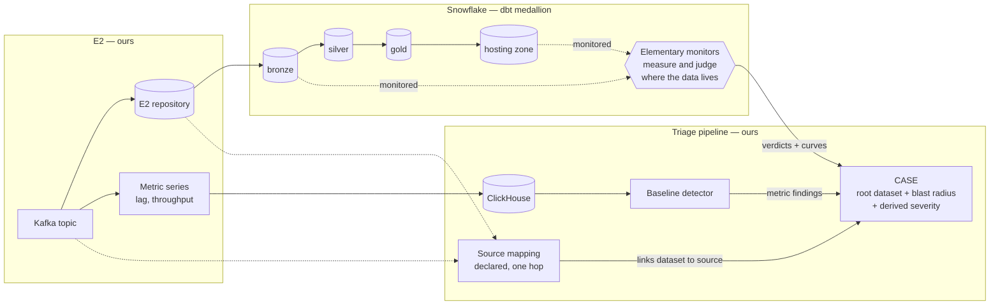

# Extending baseline anomaly detection to data-quality signal

## The ask, up front

Approve a v1 pilot that detects data-quality anomalies on the E2 ingestion path and triages them in the existing pipeline, alongside one cross-team request: that the dbt platform ship Elementary and a standard monitor set as a default. Endorse the direction — detect in Snowflake now, move detection into our own store later — without committing to the second half.

Nothing here is built. The system is greenfield, so every contract change below is a design choice, not a migration.

## Problem

We detect anomalies in operational metric series — Kafka consumer lag, throughput — and turn them into triaged cases. We detect nothing about the data those topics carry. The failures that reach consumers are usually not "the broker was down"; they are "the table has a third of yesterday's rows", "a column went null", "the load never ran". Today those are found by a consumer noticing, which means the blast radius is already downstream and the person who notices is the person least able to fix it.

The second problem is correlation. Even where data-quality checks exist as dbt tests, their results live in a different system from the operational signal, keyed differently, read by different people. A stalled consumer group and the short bronze load it caused are one incident, and they arrive as two unrelated observations, or as one observation and a silence.

What we want is that both kinds of signal land in the same triaged **case**, keyed so the responder sees the cause and the impact together.

## What we already have, and what it assumes

The baseline detector computes a modified z-score over MAD against seasonal buckets held in Redis, rebuilt weekly from Prometheus. The mathematics is series-agnostic. Everything around it is not: buckets derive from the hot-path cycle time rather than from the observation's own timestamp; bucketing is fixed at hour-of-week for every series; zero-variance series are silently skipped; a finding requires two co-deviating metrics in a scope; scope identity is built from Prometheus labels and rejects anything without `env`, `cluster_id` and `topic`; severity is hard-coded; and the finding vocabulary is a closed set of Kafka families.

We state that plainly rather than claiming the abstraction generalises: it was shaped by its only user. The seam we propose sits one level lower — **a baseline is computed over a series identity plus the observation's own time**, with cadence, bucketing, minimum history and gating treated as properties of the series kind (ADR-0001). That reframing is what lets a once-a-day **DQ measurement series** and a 300-second **metric series** share a detector at all.

## Solution

Data-quality measurements are produced where the data lives. dbt builds the medallion zones in Snowflake; Elementary is a dbt package whose monitors *are* dbt tests, writing a time-bucketed measurement history (`data_monitoring_metrics`) and verdicts (`elementary_test_results`) into tables it builds itself. Adding it needs no new detection infrastructure — only an egress path and a contract.

The triage pipeline then does the part only it can do: link the dataset back to the **source** that fed it, correlate the data-quality anomaly with operational anomalies in the same window, decide the **root**, gather the **blast radius**, derive severity, and route.

The solid line through the zones is data; dbt moves every hop of it from the E2 repository onward. The dotted lines are what this proposal adds: monitors on the entry and exit zones, and the one declared hop that lets a dataset anomaly and a topic anomaly become the same case.

### Linking a dataset to a source

Correlation needs an entity link, and dataset identity shares nothing with topic identity. dbt's `manifest.json` covers every hop from the first dbt-visible table onward — including E2 repository → bronze, which is itself a dbt job. The single hop no tool in our stack records is **source → landing table**. We declare that one hop in a **source mapping** and derive everything downstream from dbt lineage (ADR-0002). Time co-occurrence alone was rejected: it would correlate every dataset with every lag spike in the same window.

E2 is ours, so that mapping is ours to declare, keep correct, and eventually emit natively.

### Case shape

Case identity today is Kafka-shaped. We extend it to two shapes: an **infrastructure scope** or a **dataset**. Where both fire and the source mapping links them, they merge into one case (ADR-0003). Infrastructure scope is a family, matching the two source shapes: a Kafka scope for the E2 path, a job scope for an IDP feed. v1 implements the Kafka shape only, but keying on the family is what makes the batch path a later *shape* rather than a second kind of case.

Because data flows through zones, one upstream problem surfaces as an anomaly in every monitored zone below it, so a dataset-keyed case is keyed on the **root dataset** — the most upstream dataset anomalous in the window — and anomalies below it attach as **blast radius** rather than opening cases of their own. The root also decides routing: an infrastructure root goes to platform on-call, a dataset root to the dataset owner.

This is the largest single contract change in the proposal.

### Findings, correlation, severity

- **One anomalous measurement raises a finding** (ADR-0009). The metric path's two-series corroboration gate exists because a lone noisy Prometheus series means little; a dataset may carry one monitor, and requiring corroboration would discard most of the signal this proposal exists to catch. Corroboration instead *raises severity*.
- **Correlation uses the measurement's own interval**, widened by a lead-in margin (ADR-0008). A measurement describes a bucket of loaded data and is written when the job finishes, so the ingestion stall that caused a short load sits well before the measurement's timestamp. A fixed lookback would need retuning per bucket size; the margin is one number to defend.
- **Severity is derived**, not hard-coded: from how close the root sits to consumers (a hosting root outranks a bronze root), from blast radius size, and from a per-family table in which silence outranks drift.

### Silence

Detection inside the pipeline cannot see the pipeline stopping. If a dbt job never runs, Elementary produces no verdict and no measurement, and the quietest failure mode produces the quietest signal. We therefore treat **silence** — an expected measurement that has not arrived within its series' cadence — as a first-class finding raised by the triage pipeline, with the cadence learned from the series' own observation history and a declared override. Taking cadence from the producing schedule would be more accurate but reintroduces a dependency on platforms we do not all own.

### What a case carries, and when it closes

A verdict alone is a notification, not something anyone can triage. A data-quality case carries the verdict, the recent measurement curve with its expected range, and the ordinary dbt checks that failed on the same dataset in the same run as context.

**A passing test does not close a case.** An Elementary anomaly test fires on every run while the bad bucket is inside `backfill_days` (default two days) and then silently returns to pass, whether or not anything was fixed. Closing on pass would auto-resolve live incidents. A case closes when the series produces in-range measurements for several consecutive buckets, or when a human resolves it. Repeat verdicts on an open case attach as recurrences, deduplicated on Elementary's own key; its suppression state is an `edr` CLI feature invisible to a table reader, so deduplication is ours.

## The two options, and the recommendation

Both options put metric series in ClickHouse. Greenfield makes that a platform choice rather than a migration, and it removes the weekly Prometheus rebuild of Redis buckets, since history then lives in the table (ADR-0005). The options differ on **one axis: where data-quality detection runs**.

| | **Option C — detect in Snowflake** | **Option A — detect in ClickHouse** |
|---|---|---|
| Who judges | Elementary, inside the dbt run | Our baseline detector |
| Measurements | Stay where they are produced | Copied out of Snowflake into ClickHouse |
| Detector work needed | None | The ADR-0001 seam change first |
| New pipeline | Verdict egress only | Measurement copy + egress |
| Correlation input | Verdict plus a fetched curve | Raw curves, natively |
| Cost lands on | The dbt platform's warehouse | Our own infrastructure |
| Coverage ceiling | What dbt can see | Any measurement producer |

**Recommended: C now, A as the target.** C needs no detector change and no copy pipeline; the series already exist where the data lives. We move to A when any of these becomes true (ADR-0006):

1. Elementary's z-score proves too noisy to triage;
2. correlation needs the raw curves rather than verdicts;
3. a producer of measurements outside dbt appears that Elementary cannot see.

Two design choices keep that door open at no cost. The finding vocabulary uses **our own DQ families** (volume, null rate, freshness, silence), not Elementary's test names, so the contract survives the switch. And reading the curve in C is a rehearsal of A — if pulling curves dominates polling cost, that is itself evidence for switching.

Option B (data quality in Snowflake, metrics in ClickHouse, two detectors, no shared contract) was considered and dropped: it is C with the correlation goal abandoned.

### Verdict egress

Baseline: the pipeline polls Elementary's result tables in Snowflake, watermarking on `created_at`. Three caveats we have verified and must design around: those tables are append-only with no purge; `created_at` is recorded in *session* timezone, not UTC, unlike its sibling columns; and `id` values repeat, so they cannot serve as a watermark. An open question below proposes a cheaper path.

## v1 scope: the E2 path only

v1 monitors datasets fed by **E2**, the Kafka ingestion platform we own, and follows them from the E2 repository through bronze to the hosting zone (ADR-0011). We own the topics, the repository tables, their load timestamps, and the Kafka metric series on the other side of the correlation, so the entire loop can be proved without waiting on another team.

The IDP batch path is deliberately deferred. Every ingredient it needs — job metrics, OpenLineage emission, load timestamps on bronze — is a request to IDP's owners, and none is needed to show the idea works.

This trades breadth for speed, and the reviewer will reasonably ask why the pilot skips half the ingestion landscape. The answer is that the *design* already covers it: the source mapping is path-agnostic, case identity is keyed on datasets rather than Kafka scopes, and the IDP requests are written up with fallbacks. What v1 does not do is prove the batch half in practice. The compensation is that the IDP asks then arrive with a working system behind them rather than as a prerequisite.

The demonstrable v1 correlation story is concrete: consumer lag or throughput trouble on a topic, and a volume or null-rate anomaly on the bronze table it lands in, in one case, routed to one owner.

## Why not OpenLineage, and why not Cortex

**OpenLineage** was the research's starting point as the carrier for data-quality signal, and it carries less than we need: column-level distributions have no first-party producer outside Great Expectations, streaming ingestion emits no statistics facets, and the Spark–Snowflake connector probably never fills the output counters we would read. Manual emission is real and cheaper than expected at platform level (a Spark `ServiceLoader` facet builder, Airflow's `custom_run_facets`) — but dbt has no extension point at all, and emitting a measurement means measuring it ourselves, which is Elementary's job.

So v1 takes **no OpenLineage dependency**, which is what removes the last external blocker. It remains the convergence path for lineage, on our own schedule for E2, and publishing our declared source mapping as OpenLineage events is a stated bonus: it fills an ingestion hop the org's lineage tooling also lacks (ADR-0004).

**Snowflake Cortex `ANOMALY_DETECTION`** was researched as a detector and is an evaluated upgrade path, not v1. It is better statistics than a z-score (gradient-boosted at ≥12 points, non-linear at ≥60), but it needs explicit models, manual retraining, and the same egress problem, and it would bind detection harder to Snowflake at exactly the moment the stated target is to move detection out.

## What the pipeline is allowed to read

Elementary stores up to five whole raw failing rows per ordinary dbt test in `test_result_rows`. Those are real business records and may contain personal data, and our pipeline writes casefiles to MinIO, outside Snowflake.

The claim we want to make in review is simple: **the triage pipeline holds aggregates about data, never the data.** Concretely (ADR-0010): grant the pipeline's role `USAGE` on database and schema and `SELECT` table by table, *excluding* `test_result_rows`; propose `test_sample_row_count: 0` so samples are not collected at all; and keep out of the v1 monitor set the two anomaly tests that carry raw values — `dimension_anomalies`, which writes column values verbatim, and freshness's raw timestamp fields. This is far cheaper designed in than retrofitted, and it keeps Option A honest, since copying measurements then stays a copy of aggregates.

One caveat for whoever implements it: Elementary's sample-gating flags are mostly undocumented and were found by reading its source, so they need verifying against the installed version.

## What it costs

Elementary's monitors are dbt tests. They run in the dbt platform's warehouse, on the dbt platform's credit, which is a real fact to put in front of the reviewer rather than hide: **we are proposing spend on someone else's budget line.** We have no credit estimate and will not invent one — no published benchmarks exist for Elementary at any scale, and any number we produced would be a guess dressed as evidence.

What we can state precisely is the *shape* of the cost and the knobs that control it:

- **`timestamp_column`.** A monitored table without one is full-scanned on every run, produces one point per run, and supports no freshness monitor. With one, Elementary scans incrementally.
- **Materialisation.** Bucket reuse applies only to dbt sources and incremental models. A `table`-materialised model recomputes its whole training window every run.
- **Monitor set.** `all_columns_anomalies` issues two queries *per column*; the standard set uses `column_anomalies` on key columns instead.
- **Zones.** v1 monitors bronze and hosting, not every model in between.

Cost is therefore bounded by the timestamp column and the materialisation, not by monitor count alone. The honest recommendation to the platform team is that these four knobs, not a credit ceiling, are what to agree on.

## Requests of other platforms

One request is live in v1; the rest prepare v2. Each carries a fallback, so none of them blocks.

| Request | Owner | Why | Fallback |
|---|---|---|---|
| **Ship Elementary and a standard monitor set as a dbt platform default, opt-out per dataset** | dbt platform team (in our org) | Monitors are declared in `schema.yml`, and dbt jobs are owned by data owners, one team per dataset. If coverage depends on each owner opting in, the datasets whose owners never get round to it are exactly the ones that fail unnoticed — coverage would correlate with diligence rather than risk (ADR-0007). | Monitor bronze sources and the hosting zone ourselves. Covers the v1 zones; does not scale past them. |
| IDP emits job metrics | IDP platform | The batch half of the correlation: infrastructure signal to pair a data-quality anomaly with | Data-quality anomaly with no correlated cause; case still raised |
| IDP enables OpenLineage | IDP platform | Replaces the declared source → landing table hop for batch feeds | Declared source mapping (ADR-0002) |
| IDP adds a load timestamp to bronze loads | IDP platform | Without it a source gets volume only, one value per run, and no freshness | Volume-only monitoring of those datasets |

The standard set is volume, freshness, and `column_anomalies` on key columns — excluding `all_columns_anomalies` on cost and `dimension_anomalies` on privacy. Load timestamps on E2 repository tables are ours and we will add them.

**This is what we would ask the distinguished engineer to sponsor**: the dbt-platform default is an organisational conversation, not a technical one, and it is the single place our influence is best spent.

## How we would know it worked

- **Incidents caught before a consumer reported them.** The headline measure, and the reason the proposal exists.
- **Share of data-quality cases arriving already correlated** with an infrastructure anomaly. Measures the correlation claim specifically, rather than detection in general.
- **False positive rate per dataset per week.** The deciding measure. A data-quality detector that cries wolf gets muted, and a muted detector is worse than none because it is believed to be working. If this number is bad, that is the evidence for switching to Option A, or for revisiting sensitivity — not for adding suppression.

Two facts frame all three. Elementary needs roughly **two weeks** of history before its baseline is useful and roughly **fourteen** before seasonal comparison works, so the pilot should not be judged before then. And the pilot deliberately covers one ingestion path, so none of these numbers generalises to IDP.

## Open questions

- **Egress transport.** Polling a Snowflake results table is the baseline, and it works. A Snowflake Python stored procedure writing to Kafka directly would remove the poller, the watermark and its timezone trap — the Snowflake Kafka connector is ingest-only, so this is the only outbound-to-Kafka shape available. Worth a spike, and an optimisation rather than a dependency.
- **Lead-in margin.** ADR-0008 makes it one number. Its value comes from the pilot, not from the design.

## Not covered

- **Cross-platform reconciliation.** The hosting zone is also delivered to Databricks and an on-prem lakehouse. Whether those copies match is a different problem — reconciliation, not anomaly detection — and it needs its own proposal.
- **Silver and gold monitoring.** v1 monitors bronze and hosting: the entry and the exit. The zones between are where cost grows fastest and diagnostic value is lowest.
- **Checks as baselined signal.** A dbt test result is pass/fail and is carried as case context, not treated as a series.
- **Flink.** No data-quality signal from stream processing in v1.
- **Snowflake Cortex.** Evaluated, documented, not chosen.
- **The IDP batch path.** Deferred to v2 by ADR-0011, with its requests listed above. Its telemetry correlates with its data-quality anomalies the same way the Kafka path's does; what is missing is the signal, not the design.
- **Infrastructure signal above the source.** A service's CPU and memory sit a level above a topic, and one E2 application serves many topics, so one such anomaly is a shared cause across several cases at once. The generalisation is already implied by ADR-0003 — the root is the most upstream anomalous *node*, in a graph that is dbt lineage below the landing table and the source mapping above it — and extending that graph upward by a level is v2 design work, not a redesign. The same section is where run-level identifiers belong: an OpenLineage run id for batch, an exemplar's trace id for a long-running service, each turning a correlation from circumstantial into pinned.

## References

Vocabulary: `CONTEXT.md`.

Decisions: `docs/adr/0001`–`0011`, all `status: proposed`.

Research (primary sources, cited per claim): `research-elementary-operations-2026-09-22.md`, `research-medallion-path-facts-2026-09-22.md`, `research-manual-openlineage-emission-2026-09-22.md`, `research-snowflake-cortex-dq-anomaly-detection-2026-09-21.md`, `research-clickhouse-metrics-and-openlineage-storage-2026-09-07.md`, `openlineage-data-quality-facets-research.md`.
