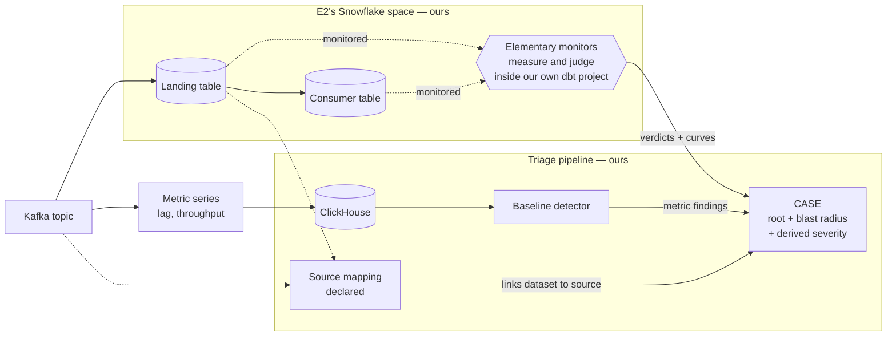
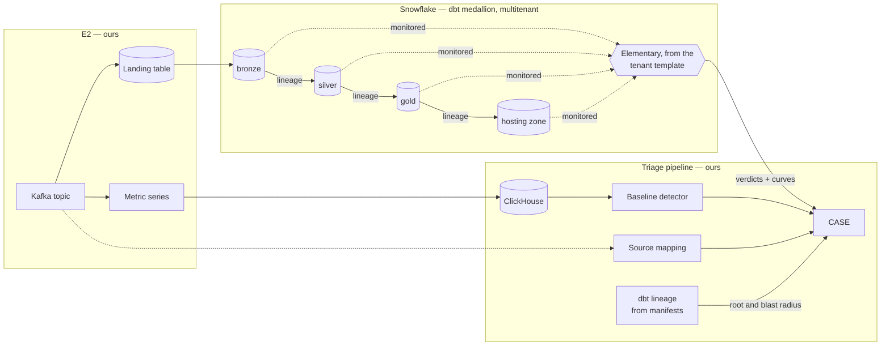

# Extending baseline anomaly detection to data-quality signal

## The ask, up front

We can build all of this without anyone's permission. The proving run lives in E2's own Snowflake space, monitored by our own dbt project, correlated against metric series we already collect. Nothing here is blocked on another team, and nothing here is live, so every contract below is a design choice rather than a migration.

What we are asking for is the three things a reviewer can give that we cannot give ourselves:

1. **Agreement on the direction.** Data-quality and infrastructure signal converge into one triaged case. Detection starts in Snowflake, where the data lives, and the seam that lets it move into our own store is built now rather than promised.
2. **Agreement on the evidence bar.** The thresholds in *How we would know it worked* are committed before the numbers exist: a false-positive ceiling, a cost ceiling, and a rule for what a weak correlation result means. Approving a decision rule is the part that makes the later conversation short.
3. **Advance warning of the ask that is coming.** After the proving run, we will ask the dbt platform to carry a standard monitor set and our read grants in its tenant template. That is an organisational conversation, and it goes better pre-socialised than cold.

## Problem

We detect anomalies in operational metric series — Kafka consumer lag, throughput — and turn them into triaged cases. We detect nothing about the data those topics carry. The failures that reach consumers are usually not "the broker was down"; they are "the table has a third of yesterday's rows", "a column went null", "the load never ran". Today those are found by a consumer noticing, which means the blast radius is already downstream and the person who notices is the person least able to fix it.

The second problem is correlation. Even where data-quality checks exist as dbt tests, their results live in a different system from the operational signal, keyed differently, read by different people. A stalled consumer group and the short load it caused are one incident, and they arrive as two unrelated observations, or as one observation and a silence.

What we want is that both kinds of signal land in the same triaged **case**, keyed so the responder sees the cause and the impact together.

## What we already have, and what it assumes

The baseline detector computes a modified z-score over MAD against seasonal buckets held in Redis, rebuilt weekly from Prometheus. The mathematics is series-agnostic. Everything around it is not: buckets derive from the hot-path cycle time rather than from the observation's own timestamp; bucketing is fixed at hour-of-week for every series; zero-variance series are silently skipped; a finding requires two co-deviating metrics in a scope; scope identity is built from Prometheus labels and rejects anything without `env`, `cluster_id` and `topic`; severity is hard-coded; and the finding vocabulary is a closed set of Kafka families.

We state that plainly rather than claiming the abstraction generalises: it was shaped by its only user. The seam we propose sits one level lower — **a baseline is computed over a series identity plus the observation's own time**, with cadence, bucketing, minimum history and gating treated as properties of the series kind (ADR-0001). That reframing is what lets an hourly **DQ measurement series** and a 300-second **metric series** share a detector at all — and a once-daily IDP series after them, without a third code path.

Those properties are declared in one **series-kind registry** rather than scattered across the tools that read them (ADR-0018), which is what makes "registering a second series kind" the actual shape of the work later rather than a figure of speech. The registry also fixes bucket width by rule rather than preference: the smallest shortfall a volume monitor can see is about one load unit spread over the bucket, so a bucket should hold a small number of load units. E2's consumer table is copied every 15 minutes, so an hourly bucket holds four and one failed copy is a 25% drop; a daily bucket would hold ninety-six and the same failure would be a 1% drop, invisible. A once-daily IDP load gets daily buckets by the same rule.

On the metric side the same seam forces one further change. A metric anomaly needs a time extent for correlation to compare it against anything, and today it has none — the hot path reads Prometheus with instant queries and buckets on the scheduler's cycle time. Consecutive deviating cycles therefore collapse into one **deviation episode** with a first and last observation time, and the finding is raised on the episode (ADR-0019). Without that, a stall straddling a bucket boundary becomes several correlated fragments and several orphans, and the correlated share we commit to measuring would move with scheduler alignment rather than with incidents.

We build that seam in v1, on the metric path, even though v1 detects data-quality anomalies in Snowflake. Metric series move to ClickHouse in v1 regardless (ADR-0005), so the storage layer is being touched anyway, and building the seam then is what turns Option A from a migration into the registration of a second series kind. Nothing is live, so the hot path is rebuilt against the seam rather than migrated behind it.

## Solution

Data-quality measurements are produced where the data lives. Elementary is a dbt package whose monitors *are* dbt tests, writing a time-bucketed measurement history (`data_monitoring_metrics`) and verdicts (`elementary_test_results`) into tables it builds itself. Adding it needs no new detection infrastructure — only an egress path and a contract.

The triage pipeline then does the part only it can do: link the dataset back to the **source** that fed it, correlate the data-quality anomaly with operational anomalies in the same window, decide the **root**, gather the **blast radius**, derive severity, and route.

### The proving run

E2 sits outside the medallion architecture. It owns a repository and a Snowflake space holding the **landing table** its topic data arrives in and the **consumer table** it exposes for reading. v1 runs entirely there — three nodes, all ours, mimicking at small scale the downstream movement the medallion performs at large scale.

**Neither hop is a daily batch.** The topic streams into the landing table continuously, and a separate job copies the landing table into the consumer table every 15 minutes (ADR-0011). The path carries two cadences, and the second of them is what makes the proving run useful: a once-daily path would exercise one bucket a day, whereas this one exercises the full chain every hour. The consumer table carries the landing row's load timestamp through rather than stamping its own at copy time (ADR-0017), so both tables bucket on the same clock and a catch-up after a stall refills the bucket that was short instead of appearing as a spike in a later one.

Monitors run from a minimal dbt project of ours that declares those two tables as **sources** and builds no models — which is also the materialisation Elementary's bucket reuse actually supports. It needs a Snowflake role and a warehouse, not another team's agreement.

### Where this goes

The same machinery, applied to the medallion, is the end state. It is drawn second deliberately: it is the ambition, not the deliverable.

Two things in that picture are v2 requests rather than v1 mechanisms: monitors arriving through the platform's tenant template, and lineage derived from dbt manifests.

### Linking a dataset to a source

Correlation needs an entity link, and dataset identity shares nothing with topic identity. The hop from **source → landing table** is recorded by no tool in our stack, and the OpenLineage research says streaming ingestion is unlikely to start recording it soon. We declare it in a **source mapping** (ADR-0002). Time co-occurrence alone was rejected: it would correlate every dataset with every lag spike in the same window.

We had intended to declare that one hop and derive everything below it from dbt's `manifest.json`. **Those manifests are not available to us**, and on a self-serve multitenant platform there is no single manifest spanning bronze to hosting in any case. So the graph is declared end to end (ADR-0015). On the E2 path that is cheap and honest — three nodes we own. Across the medallion it would not be, which is exactly why manifest access is a v2 prerequisite rather than a convenience. A topic may feed several landing tables; a landing table fed by two sources is rejected at declaration, because it makes the root ambiguous.

### Case shape

Case identity has three keys: an **infrastructure scope**, a **root dataset**, and a **storm** keyed on an environment and cluster. Where a scope and a dataset both fire and the source mapping links them, they merge into one case (ADR-0003). Infrastructure scope is a family — a Kafka scope for the E2 path, a job scope for an IDP feed — so the batch path is later a new *shape* rather than a second kind of case.

Because data flows downstream, one upstream problem surfaces everywhere below it, so a dataset-keyed case is keyed on the **root dataset**: the most upstream *monitored* dataset anomalous in the window, over the declared graph. Anomalies below it attach as **blast radius** rather than opening cases of their own.

The word *monitored* is load-bearing. A defect introduced where nothing is monitored surfaces as a root further downstream than its true cause, so a case whose root has a clean monitored ancestor is marked **transform-suspected** and is not attributed to the root's owner. How often that happens is something the proving run measures, because it is the evidence for how much lineage coverage v2 needs.

Above all of this sits the storm case (ADR-0014). A cluster-wide incident makes every topic anomalous and every landing table short at once; without a rollup that is hundreds of cases describing one event. Above five co-firing scopes in one cluster, they become one storm case with the scope cases as children, notifying once.

### Findings, correlation, severity

- **One anomalous measurement raises a finding** (ADR-0009). The metric path's two-series corroboration gate exists because a lone noisy Prometheus series means little; a dataset may carry one monitor, and requiring corroboration would discard most of the signal this proposal exists to catch. Corroboration instead *raises severity*.
- **Correlation uses the measurement's own interval**, extended backwards by a lead-in margin of half a bucket (ADR-0008). A measurement describes a bucket of loaded data and is written when the job finishes, so it must never be correlated against a fixed lookback from its own timestamp — that would need retuning for every bucket size. The margin is *derived* from bucket width rather than configured: on a load timestamp the failure that shortened a bucket almost always falls inside that bucket, so the margin exists only to catch a deviation straddling a boundary, and its natural scale is the bucket. This depends on `timestamp_column` being a load timestamp. On a business event timestamp the bucket describes when events happened, so the ingestion failure sits *after* `bucket_end` and a lead-in margin widens the window away from the cause.
- **A bucket that has not closed is not evidence** (ADR-0009). The bucket currently filling describes a partial hour, which Elementary scores against complete ones and finds a shortfall that does not exist — one false verdict per series per run with hourly buckets and hourly runs. The pipeline ignores any verdict or measurement whose `bucket_end` is in the future. One predicate, three readers: finding ingest, auto-close, and silence all need it, which is why it lives with us rather than in Elementary's undocumented `detection_delay`.
- **Severity is derived**, not hard-coded: from how close the root sits to consumers, from blast radius size, and from a per-family table in which silence outranks drift.

### Silence

Detection inside the pipeline cannot see the pipeline stopping. If a job never runs, Elementary produces no verdict and no measurement, and the quietest failure mode produces the quietest signal. We treat **silence** — an expected measurement that has not arrived within its series' cadence — as a first-class finding raised by the triage pipeline.

The set of series expected to produce is derived from the declared graph and the monitors we declare, not from what we have observed. Cadence for the v1 set is **declared**, with learning from observation history as the scaling path. Learned cadence was our first instinct and it is blind exactly where silence matters most: there is no history during the first two weeks, and a series that has *never* produced has nothing to learn from — so a dataset whose load never runs at all would be invisible. At tens of entries a declared list does not rot; at hundreds it would, and that is when learning takes over.

### What a case carries, and when it closes

A verdict alone is a notification. A data-quality case carries the verdict, the recent measurement curve with its expected range, and the ordinary dbt checks that failed on the same dataset in the same run as context.

**A passing test does not close a case.** An Elementary anomaly test fires only while the bad bucket is inside `backfill_days` (default two days) and then silently returns to pass, whether or not anything was fixed. A case closes when the series produces in-range measurements for **three consecutive buckets**, or when a human resolves it — and an absent measurement is silence, not recovery, so auto-close never fires on a bucket Elementary did not write. Three buckets means three of that kind's buckets, so recovery is about three hours on E2's hourly series and several days on a daily one.

That rule makes **curve polling mandatory, not enriching**: "in range" is observable only from `data_monitoring_metrics`, never from verdicts. Which is itself an argument about the options — reading curves is load-bearing in Option C, so the cost balance tilts toward Option A by more than the original framing suggested.

Repeat verdicts on an open case attach as recurrences, deduplicated on Elementary's own key; its own suppression state is an `edr` CLI feature invisible to a table reader, so deduplication is ours.

## The two options, and the recommendation

Both options put metric series in ClickHouse. Greenfield makes that a platform choice rather than a migration, and it removes the weekly Prometheus rebuild of Redis buckets, since history then lives in the table (ADR-0005). The options differ on **one axis: where data-quality detection runs**.

| | **Option C — detect in Snowflake** | **Option A — detect in ClickHouse** |
|---|---|---|
| Who judges | Elementary, inside the dbt run | Our baseline detector |
| Measurements | Stay where they are produced | Copied out of Snowflake into ClickHouse |
| New pipeline | Verdict egress and curve polling | Measurement copy and egress |
| Correlation input | Verdict plus a fetched curve | Raw curves, natively |
| Cost lands on | The warehouse running dbt | Our own infrastructure |
| Coverage ceiling | What dbt can see | Any measurement producer |

**Recommended: C now, A as the target.** C needs no measurement copy; the series already exist where the data lives. We move to A when any of these becomes true (ADR-0006): Elementary's z-score proves too noisy to triage; correlation needs the raw curves rather than verdicts; or a producer of measurements outside dbt appears that Elementary cannot see.

Three things keep that door genuinely open rather than nominally. The finding vocabulary uses **our own DQ families** (volume, null rate, freshness, silence), not Elementary's test names, so the contract survives the switch. Curve polling in C is a rehearsal of A. And most importantly the **ADR-0001 seam is built in v1**, so A is the registration of a second series kind rather than a refactor we would have to find appetite for at the exact moment we were unhappy with the detector.

Option B (data quality in Snowflake, metrics in ClickHouse, two detectors, no shared contract) was considered and dropped: it is C with the correlation goal abandoned.

### Verdict egress

The pipeline **re-reads a bounded 48-hour window every 15 minutes and deduplicates**, rather than advancing a watermark (ADR-0013). Three verified facts rule the watermark out: Elementary's result tables are append-only with no purge; `created_at` is recorded in *session* timezone, unlike its sibling columns; and `id` values repeat. A cursor over a column that is neither monotonic nor timezone-stable drops rows silently, which is the worst available failure mode here. Ingestion is idempotent by construction, so re-reading is free correctness. A daily reconciliation compares verdict counts in Snowflake against findings ingested, because we cannot detect our own silence.

A case therefore exists within an hour of a verdict being written. Total latency is set by bucket width and test cadence, not by this pipeline and not by the load cadence: the bucket has to close, the next `dbt test` has to run, and the poll has to come round. On E2's hourly-bucketed series tested hourly that is **a case within 75 minutes of the end of the hour the shortfall happened in** — twelve minutes if the bucket closes just before a test run, seventy-five if just after. On a daily-bucketed IDP series it is a day, because a daily bucket cannot close sooner. The monitoring project runs one schedule per cadence tier, selected by tag, because a single hourly run over daily-bucketed series would recompute the same two buckets twenty-four times a day for no new information (ADR-0018).

## v1 scope: a proving run on the E2 path

v1 covers a Kafka topic, its landing table and its consumer table, inside E2's Snowflake space (ADR-0011). No downstream consumer reads that consumer table, so this is a **proving run, not a pilot** — and the difference matters for what we are allowed to claim. It can prove the mechanism end to end, the cost, the correlation rate and the false-positive behaviour. It cannot prove that incidents were caught before a consumer reported them, and we do not claim it.

What we get in exchange is that we control both ends and can therefore *inject* the failures instead of waiting for them, which produces evidence in week four rather than week sixteen.

The medallion path and the IDP batch path are both v2. The design already covers them — the source mapping is path-agnostic, case identity is keyed on datasets rather than Kafka scopes — and what v1 does not do is prove them in practice. The compensation is that the requests to other platforms then arrive with a working system behind them rather than as prerequisites.

## Why not OpenLineage, and why not Cortex

**OpenLineage** was the research's starting point as the carrier for data-quality signal, and it carries less than we need: column-level distributions have no first-party producer outside Great Expectations, streaming ingestion emits no statistics facets, and the Spark–Snowflake connector probably never fills the output counters we would read. Manual emission is real and cheaper than expected at platform level — but dbt has no extension point at all, and emitting a measurement means measuring it ourselves, which is Elementary's job.

So v1 takes **no OpenLineage dependency**. It remains the convergence path for lineage, on our own schedule for E2, and publishing our declared source mapping as OpenLineage events is a stated bonus: it fills an ingestion hop the org's lineage tooling also lacks (ADR-0004).

**Snowflake Cortex `ANOMALY_DETECTION`** was researched as a detector and is an evaluated upgrade path, not v1. It is better statistics than a z-score, but it needs explicit models, manual retraining, and the same egress problem, and it would bind detection harder to Snowflake at exactly the moment the stated target is to move detection out.

## What the pipeline is allowed to read

Elementary stores up to five whole raw failing rows per ordinary dbt test in `test_result_rows`. Those are real business records and may contain personal data, and our pipeline writes casefiles to MinIO, outside Snowflake.

The claim we want to make in review is precise: **the triage pipeline holds counts, rates and timings about data, never field values.** "Aggregates, never the data" would be too loose to defend — `min`/`max` on a column is an aggregate *and* a value from a real record. Concretely (ADR-0010): grant the pipeline's role `USAGE` on database and schema and `SELECT` table by table, *excluding* `test_result_rows`; propose `test_sample_row_count: 0` so samples are never collected; keep `dimension_anomalies` and freshness's raw timestamp fields out of the monitor set; and enable `column_anomalies` monitor types by name, excluding `min`, `max`, `min_length` and `max_length`. That costs little detection power, because every failure in the problem statement is a count, a rate or a timing.

On the multitenant platform this is not a single grant. Each tenant's Elementary tables live in that tenant's own space, so `SELECT` belongs in the tenant template rather than in a conversation per team — otherwise coverage stops depending on who adds monitors and starts depending on who grants access, which is the same failure wearing a different hat. Discovery enumerates tenant schemas and reconciles against what we can read, so an ungranted tenant is a visible gap rather than a silent absence.

One caveat for whoever implements it: Elementary's sample-gating flags are mostly undocumented and were found by reading its source, so they need verifying against the installed version.

## What it costs

Elementary's monitors are dbt tests: they run in a warehouse, on someone's credit. For the proving run that someone is us. For the medallion it would be each tenant, which is a real fact to put in front of the reviewer rather than hide.

We have no credit estimate, no published benchmarks exist, and any number we invented would be a guess dressed as evidence. So the **first deliverable is a cost probe, not the pipeline**: Elementary on the proving run's tables with the standard monitor set and a `timestamp_column` present, measured in credits from `QUERY_HISTORY` and extrapolated per table per day. Days of work, and it converts our largest political risk into a number. It also doubles as the history warm-up the cold start needs anyway.

The knobs that decide the number:

- **`timestamp_column`.** Without one a table is full-scanned every run, produces one point per run, supports no freshness monitor, and writes `bucket_start` as `NULL` — which leaves correlation nothing to key on at all. It has no default, and it must be a *load* timestamp rather than a business event timestamp (ADR-0008).
- **`time_bucket`.** Hourly multiplies rows in `data_monitoring_metrics` roughly 24× against the daily default, and the finest period Elementary offers is `hour`. It is not a free knob: it is part of the identity Elementary keys stored history on, so changing it forks that history and forces a full `days_back` recompute. Bucket width is settled before the probe, not after, and by the rule in ADR-0018 rather than by cost alone.
- **Materialisation.** Bucket reuse applies only to dbt sources and incremental models. A `table`-materialised model recomputes its whole training window every run.
- **Monitor set.** `all_columns_anomalies` issues two queries *per column*; the standard set uses `column_anomalies` on key columns instead.
- **Coverage.** Which tables are monitored at all.

## Requests of other platforms

**v1 has no live cross-team request.** That is a deliberate change from the first draft, which led with the dbt-platform ask. The fallback to that ask — monitor what we can reach ourselves — covers the entire proving run, so the ask is not needed to ship or to be judged, and spending influence on it now, with no evidence, risks a "not yet" that would poison the version of the request that actually matters.

These go in after Gate 2, each with a fallback, so none of them blocks:

| Request | Owner | Why | Fallback |
|---|---|---|---|
| **Standard monitor set and our `SELECT` grants in the tenant template**, opt-out per dataset | dbt platform team (in our org) | The platform is self-serve and multitenant, so coverage is decided by what a tenant's space contains at provisioning. Per-team opt-in makes coverage correlate with diligence rather than risk (ADR-0007). Monitors without grants just relocates the problem. | Monitor what we can reach ourselves. Covers the proving run; does not scale past it. |
| **Read access to dbt manifests** | dbt platform team | Root dataset and blast radius across the medallion need lineage; the declared graph does not scale past paths we own (ADR-0015) | Declared graph, path by path |
| IDP emits job metrics | IDP platform | The batch half of the correlation | DQ anomaly with no correlated cause; case still raised |
| IDP enables OpenLineage | IDP platform | Replaces the declared source → landing table hop for batch feeds | Declared source mapping |
| IDP adds a load timestamp to bronze loads | IDP platform | Without it a source gets volume only, one value per run, and no freshness | Volume-only monitoring |

Load timestamps on E2's tables are ours and we will add them.

## How we would know it worked

The headline measure is **scenario coverage** (ADR-0016). We own both ends of this path, so we inject the failures rather than waiting for them. Six scenarios, each with an expected case shape:

1. Consumer group stalls, the hour's rows land short → one case, infrastructure root, dataset anomaly merged.
2. A monitored column starts arriving null → one case, dataset root, no correlated cause.
3. The copy job stops entirely → a silence finding, not a freshness anomaly. A *single* missed copy is injected separately: an hourly bucket sees that as a 25% volume shortfall rather than as silence, so the two exercise different detectors.
4. A late-arriving backfill → **no** case.
5. A legitimate business volume spike → a case dispositioned benign-real, not wrong.
6. A cluster-wide stall across more than five scopes → one storm case with children attached.

The last two carry the most weight: a detector is proven as much by what it declines to raise as by what it raises.

Every case gets a human **disposition** — *actionable*, *benign-real*, or *wrong* — recorded by a one-command CLI, with counts on the existing dashboard. A two-way pass/fail would hide the benign-real class and push us to detune a detector that is working. This is one named person, one pass a day, for the duration: real recurring cost, and it is the instrument that produces the evidence.

Thresholds, committed now:

- **False positives:** no more than one *wrong* case per dataset per week, sustained. If we miss it, the response is Option A or revisited sensitivity — **not** suppression.
- **Cost:** under 2% of the warehouse's existing daily credits for this table set, proceed; 2–10%, proceed and carry a per-table cost table into the platform ask; above 10%, retune the knobs and re-probe before asking anyone for anything.
- **Correlated share:** above 30%, correlation stays the headline claim; 10–30%, reframe as one triage surface with correlation where it exists; below 10%, the case merge does not pay for the declared graph's upkeep and v1 becomes verdicts landing as cases with no merge.

Also measured: the share of cases that are transform-suspected, which is the evidence for how much lineage coverage v2 needs.

Two gates, because Elementary's cold start has two halves weeks apart. Hourly buckets shorten the first: a non-seasonal baseline gates on `min_training_set_size` (default 7), which on an hourly series is seven complete *hours*, not the two weeks a daily series needs. Seasonal comparison still takes roughly fourteen weeks, because `hour_of_week` seasonality multiplies `days_back` by seven and each seasonal bucket gains one sample per week:

- **Gate 1, ~4 weeks:** cost number, scenario coverage, mechanism end to end, seam built. The go/no-go, and what comes back to this reviewer.
- **Gate 2, ~16 weeks:** sustained false-positive rate, correlated share, transform-suspected share, seasonal comparison live. What backs the tenant-template request and the move to owner routing.

Any false-positive number before Gate 2 is indicative, not deciding.

### Who gets paged

Nobody outside the triage team, for now (ADR-0012). Monitors applied by convention plus routing to dataset owners would page teams that asked for nothing, from a detector whose error rate we cannot yet state — the fastest way to get the whole thing muted. Every case routes to us; we disposition and hand off by hand. Owner routing is a later step gated on the false-positive bar, which is also the moment data owners need to be told the system exists.

## Open questions

- **Egress transport.** The bounded-window poll works. A Snowflake Python stored procedure writing to Kafka directly would remove the poller entirely — the Snowflake Kafka connector is ingest-only, so this is the only outbound-to-Kafka shape available. A spike, not a dependency.
- **Two numbers from the proving run, not from the design:** the storm threshold of five co-firing scopes (ADR-0014) and the three-bucket recovery rule (ADR-0009). The lead-in margin was a third until it became a formula — half a bucket width — so the proving run validates it rather than discovering it (ADR-0008).
- **Two facts to verify against installed versions before Gate 1:** dbt's selector semantics over sources and whether Elementary's `on-run-end` hook writes results correctly for a selected subset, since the per-tier schedule depends on both (ADR-0018); and `detection_delay`'s behaviour at bucket boundaries, which decides only whether it is worth setting for cost.

## Not covered

- **Cross-platform reconciliation.** The hosting zone is also delivered to Databricks and an on-prem lakehouse. Whether those copies match is reconciliation, not anomaly detection, and it needs its own proposal.
- **Silver and gold monitoring.** v2 monitors the entry and the exit first; the zones between are where cost grows fastest and diagnostic value is lowest. The transform-suspected share is the measurement that would change our mind.
- **Checks as baselined signal.** A dbt test result is pass/fail and is carried as case context, not treated as a series.
- **Flink.** No data-quality signal from stream processing in v1.
- **Snowflake Cortex.** Evaluated, documented, not chosen.
- **The IDP batch path and the medallion.** Deferred to v2, with their requests listed above. What is missing is the signal and the lineage, not the design.
- **Infrastructure signal above the source.** A service's CPU and memory sit a level above a topic, and one E2 application serves many topics, so one such anomaly is a shared cause across several cases at once. Extending the graph upward by a level would replace the storm case's count threshold with a real shared root, and ADR-0003 is keyed so that this is an extension rather than a redesign. The same section is where run-level identifiers belong: an OpenLineage run id for batch, an exemplar's trace id for a long-running service, each turning a correlation from circumstantial into pinned.

## References

Vocabulary: `CONTEXT.md`.

Decisions: `docs/adr/0001`–`0016`, all `status: proposed`.

Research (primary sources, cited per claim): `research-elementary-operations-2026-09-22.md`, `research-medallion-path-facts-2026-09-22.md`, `research-manual-openlineage-emission-2026-09-22.md`, `research-snowflake-cortex-dq-anomaly-detection-2026-09-21.md`, `research-clickhouse-metrics-and-openlineage-storage-2026-09-07.md`, `openlineage-data-quality-facets-research.md`.
